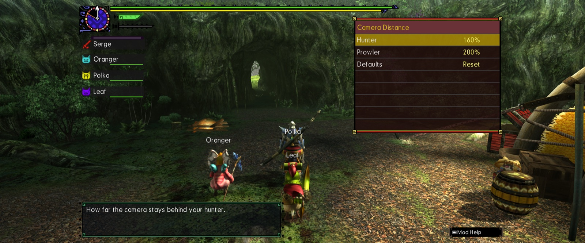
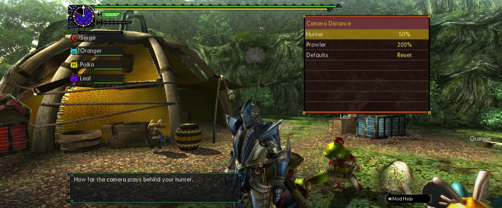

# Camera Distance

Sets how far the quest camera stays behind your hunter and behind your Prowler in **Monster Hunter Generations
Ultimate**, as a Forge plugin for [MHGU Recomp](https://github.com/morerokk/MHGURecomp).

> Only tested on MHGU Recomp (macOS), with the English game text, as a hunter and as a Prowler. It has not been tested
> on a Switch or an emulator.

| Hunter at 160% | Hunter at 50% |
| --- | --- |
|  |  |

## Features

**A distance for your hunter and one for your Prowler.** Each goes from 30% to 300% of the game's own distance, in
steps of 5%. 100% is the game's camera.

**Changes show at once.** The camera moves while you change the value, even in the middle of a quest. There's no
restart, and no game file is replaced: camera mods that ship a `quest.arc` need one copy per distance.

**Settings in the game's own menu.** With [Purple-lib](https://gamebanana.com/mods/740376) installed, open the start
menu, then **Options > Mod Options > Camera Distance**:

- **Hunter** and **Prowler**: press A, then Left and Right to change the distance, and A to keep it (B puts back the
  old value).
- **Defaults**: puts both back to 100%.
- The page has its own help: press (−) while it's open.

Without Purple-lib, the same two settings are in Forge's menu: press **Insert** in game, then open **Camera Distance**.

The settings are saved when you close the window, to `camdist.ini` next to your save, and loaded each time the game
starts.

## Requirements

- **MHGU Recomp** with **MHGU 1.4.0**, which the recomp needs anyway. Forge, which runs the plugin, is built into the
  recomp.
- **[Purple-lib](https://gamebanana.com/mods/740376) r19 or later** for the page under Options > Mod Options.
  Optional but recommended: without it, use Forge's menu (Insert) or edit `camdist.ini`.

## Install

1. Download `camera-distance-<version>.zip` from [Releases](../../releases).
2. Extract it into the recomp's `mods` folder, so that you get `mods/camera-distance/`:
   - macOS: `~/Library/Application Support/MHGURecomp/mods/`
   - Windows and Linux: the `mods` folder next to the recomp's executable
3. For the settings page in the game's menu, install Purple-lib the same way.
4. Start the game. `log.txt` should list `camera-distance: quest camera hooked`, and with Purple-lib also
   `camera-distance: settings under Options > Mod Options`.

## Settings file

`camdist.ini` sits in your save folder, next to the save itself: `save_0/camdist.ini` (by default in the recomp's
`save` folder, or in your own save folder if you set one in the recomp's settings). It's a plain text file you can edit
while the game is closed:

```ini
; Camera Distance 0.1.0: the quest camera's distance, in percent of the game's (30 to 300).
hunter = 120
prowler = 100
```

Values outside 30 to 300 are clamped. Without the file, both start at 100%.

## Uninstall

Delete the `camera-distance` folder, or turn the mod off in the recomp's Mods tab. The mod replaces no game files, so
the camera is back to the game's distance at once. You can also delete `save_0/camdist.ini`; the game's save doesn't
need it.

## Compatibility

- **Game version:** MHGU 1.4.0, which the recomp needs anyway.
- **Language:** the menu texts are in English in every game language. The camera works the same in all of them.
- **Other camera mods:** mods that edit `camera\param\questcamera` in `quest.arc` (such as
  [Camera Distance Increase](https://gamebanana.com/mods/452192)) change the same two numbers. This mod's percentages
  apply on top of theirs, so 100% keeps that mod's distance. Remove one of them unless you want both.
- **Only the quest camera** changes. The village, Gathering Hub and cutscene cameras keep their distance.

## How it works

The quest camera (`uQuestCamera`) takes its numbers from `camera\param\questcamera` in `quest.arc`. It reads them
every frame through one function (main module offset `0x1EADC`: camera, index), which asks the loaded parameter file
(camera `+0x94`, virtual function `+0x4C`). Index 0 is the hunter's distance (490 in the game's file, file offset
`0x14`) and index 2 a Prowler's (360, offset `0x1C`); the camera's update reads index 2 instead of 0 while you play as
a Prowler. The plugin hooks that function and scales those two values by your percentages, so a change shows in the
next frame.

## Building

You need an `arm-none-eabi` GCC toolchain (on macOS: `brew install arm-none-eabi-gcc`) and Python 3.

```sh
sh build.sh            # builds out/camera_distance.nro
sh build.sh install    # builds and installs into the recomp's mods/camera-distance/
sh build.sh release    # builds dist/camera-distance-<version>.zip
```

`install` uses macOS's default `~/Library/Application Support/MHGURecomp`; set `RECOMP=<path>` for another folder.

### Layout of the repository

| Path | What it is |
| --- | --- |
| `src/plugin.c` | The plugin: the camera hook, the settings file, the Purple-lib page and Forge's menu |
| `src/forge.h` | The part of Forge's plugin API (and of the game's `nn::fs`) the plugin uses |
| `src/purplelib.h` | Purple-lib's API header |
| `src/start.S`, `build/` | NRO start code, linker script and ELF to NRO converter |
| `release/README.txt` | The readme that goes in the release zip |
| `docs/` | The screenshots above |

The plugin doesn't link against Purple-lib: Purple-lib finds and calls its exported `purplelib_on_register`, so the
mod loads and works without it.

## Credits

- `src/start.S`, `build/nro.ld` and `build/elf2nro.py` come from lick-mee's
  [mhgu-gathering-map](https://github.com/lick-mee/mhgu-gathering-map) (MIT).
- `src/purplelib.h` is from PurplefinNeptuna's [Purple-lib](https://gamebanana.com/mods/740376) (MIT).
- The plugin API is [Forge](https://github.com/Fexty12573/forge) by Fexty12573.

## License

[MIT](LICENSE).
